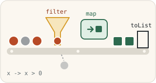

> [!NOTE]
> The English translation for this exercise can be found in [this file](./readme.en.md).

# Streamit ja lambdat



Tässä tehtävärepositoriossa perehdytään Javan Stream API:in sekä lambda-lausekkeisiin. Harjoitus on jaettu osiin, joista jokaisessa on Java-luokka, jonka keskeneräiset metodit täydennät streamien ja lambdojen avulla niiden kommenttien ja vinkkien mukaisesti. Tehtäväpaketissa ei ole pääohjelmaa, vaan jokaisella osalla on omat yksikkötestinsä.

Suositellut itseopiskelumateriaalit:

* [The Stream API (dev.java)](https://dev.java/learn/api/streams/)
* [Lambda Expressions in Java (Coding with John, YouTube)](https://youtu.be/tj5sLSFjVj4)
* [Optionals In Java (Coding with John, YouTube)](https://youtu.be/vKVzRbsMnTQ)
* [The Java 8 Stream API Tutorial (baeldung.com)](https://www.baeldung.com/java-8-streams)

## Tehtävän aloittaminen

Forkkaa ensin tämä repositorio omaan GitHub-repositorioosi GitHubin **Fork**-painikkeella ja kloonaa vasta sitten oma forkkisi koneellesi:

```sh
git clone https://github.com/<oma-github-tunnuksesi>/6-streams-and-lambdas.git
```

Avaa kloonattu projekti koodieditorissasi.

## Testaaminen

Tehtävän osille on valmiit [JUnit](https://junit.org/)-yksikkötestit hakemistossa [src/test/java](./src/test/java/). Kunkin osan kohdalla kerrotaan, millä testiluokalla se arvioidaan. Voit ajaa testit koodieditorisi testaustyökalulla ([VS Code](https://code.visualstudio.com/docs/java/java-testing), [Eclipse](https://www.vogella.com/tutorials/JUnitEclipse/article.html)) tai [Gradlella](https://docs.gradle.org/current/userguide/java_testing.html), esimerkiksi:

```
./gradlew test --tests IntegerStreamsTest        # unix
.\gradlew.bat test --tests IntegerStreamsTest    # windows
```

Lisää komennon loppuun `--info`, jos haluat tarkemmat tiedot epäonnistuneista testeistä. Testien tekniseen toteutukseen ei tarvitse perehtyä, ja voit kokeilla ratkaisuasi myös omalla `main`-metodilla. Saat kirjoittaa omia testejä lisää, mutta älä muuta tai poista valmiita testejä.

Älä muuta valmiiden luokkien, metodien ja konstruktorien nimiä, parametreja tai paluuarvojen tyyppejä, sillä silloin testit eivät käänny. Saat tiedoston alkuperäisen version takaisin komennolla `git restore <tiedoston polku>` tai kurssijärjestelmän **Palauta lähtökoodi** -toiminnolla.

## Palauttaminen ja pisteet

Jokaisella tehtävän osalla on kurssijärjestelmässä (https://jtjuslin.kapsi.fi/java) oma sivunsa, jonka koodikentissä on osan koodipohja. Kopioi ratkaisusi koodikenttiin tai kirjoita se suoraan niihin. **Testaa ilman palautusta** ajaa osan testit tallentamatta pisteitä, ja **Lähetä** palauttaa ratkaisun. Jokainen testiluokka hyväksytään vain, jos sen kaikki testit menevät läpi, ja pisteet jaetaan hyväksyttyjen testiluokkien mukaan.

**Pisteet kahdessa vaiheessa**

1. Kun ratkaisusi menee läpi kurssijärjestelmässä, saat osasta **puolet pisteistä**.
2. Pushaa lopuksi kaikki julkiseen GitHub-repositorioosi. Paina tämän jälkeen osan sivulla **Lähetä tarkistettavaksi** -nappia. Kun testit menevät läpi, saat osasta **täydet pisteet**. Repositorio saa jäädä julkiseksi.

GitHubissa ei ole arvioivaa YAML-tehtävävirtaa (GitHub Actions -workflowta), eikä `git push` käynnistä arviointia. Kun painat **Lähetä tarkistettavaksi**, kurssijärjestelmän botti hakee koodisi repositoriostasi ja tarkistaa sen samoilla testeillä. Molemmat vaiheet pitää tehdä ennen luvun määräaikaa. Voit lähettää ratkaisusi niin monta kertaa kuin tarvitset, ja voimaan jää paras tulos.


## Osa 1: IntegerStreams *(perusteet, 10 %)*

Opit käyttämään [IntStream-luokan](https://docs.oracle.com/en/java/javase/17/docs/api/java.base/java/util/stream/IntStream.html) valmiita metodeja, jotka tekevät tyypillisiä laskuoperaatioita kokonaislukuja sisältäville streameille. Täydennä [IntegerStreams](./src/main/java/part01/IntegerStreams.java)-luokan metodit.

Arvioinnissa ajetaan testiluokka [IntegerStreamsTest](./src/test/java/part01/IntegerStreamsTest.java).


## Osa 2: OptionalValues *(perusteet, 10 %)*

Opit käsittelemään tilanteita, joissa stream ei välttämättä sisällä yhtään arvoa, mikä pitää huomioida esimerkiksi keskiarvoa tai ääriarvoja laskettaessa. Java käyttää tällöin "optional"-olioita: [Optional](https://docs.oracle.com/en/java/javase/17/docs/api/java.base/java/util/Optional.html), [OptionalDouble](https://docs.oracle.com/en/java/javase/17/docs/api/java.base/java/util/OptionalDouble.html) ja [OptionalInt](https://docs.oracle.com/en/java/javase/17/docs/api/java.base/java/util/OptionalInt.html). Täydennä [OptionalValues](./src/main/java/part02/OptionalValues.java)-luokan metodit.

Arvioinnissa ajetaan testiluokka [OptionalValuesTest](./src/test/java/part02/OptionalValuesTest.java).


## Osa 3: ListsAndStreams *(perusteet, 10 %)*

Opit luomaan streameja listoista ja muodostamaan listoja streameista. Täydennä [ListsAndStreams](./src/main/java/part03/ListsAndStreams.java)-luokan metodit.

Arvioinnissa ajetaan testiluokka [ListsAndStreamsTest](./src/test/java/part03/ListsAndStreamsTest.java).


## Osa 4: MappingStreams *(perusteet, 10 %)*

Opit muodostamaan uusia streameja muuntamalla olemassa olevan streamin arvoja. Muunnokset toteutetaan tyypillisesti lambda-lausekkeina. Täydennä [MappingStreams](./src/main/java/part04/MappingStreams.java)-luokan metodit.

Arvioinnissa ajetaan testiluokka [MappingStreamsTest](./src/test/java/part04/MappingStreamsTest.java).


## Osa 5: FilteringStreams *(perusteet, 10 %)*

Hyvin tavallinen streamien käyttötapaus on aineiston suodattaminen. Opit valitsemaan streamista vain tietyt ehdot täyttävät arvot uuteen streamiin. Täydennä [FilteringStreams](./src/main/java/part05/FilteringStreams.java)-luokan metodit.

Arvioinnissa ajetaan testiluokka [FilteringStreamsTest](./src/test/java/part05/FilteringStreamsTest.java).


## Osa 6: PredicatesWithStreams *(perusteet, 10 %)*

Opit tarkistamaan koko streamia koskevia ehtoja. Täydennä [PredicatesWithStreams](./src/main/java/part06/PredicatesWithStreams.java)-luokan metodit.

Arvioinnissa ajetaan testiluokka [PredicatesWithStreamsTest](./src/test/java/part06/PredicatesWithStreamsTest.java).


## Osa 7: ObjectStreams *(soveltava, 10 %)*

Sovellat streameja oman [Person](./src/main/java/person/Person.java)-luokan kanssa ja huomaat, että omien luokkien käsittely streameilla on hyvin samanlaista kuin Javan valmiiden tietotyyppien. Täydennä [ObjectStreams](./src/main/java/part07/ObjectStreams.java)-luokan metodit.

Arvioinnissa ajetaan testiluokka [ObjectStreamsTest](./src/test/java/part07/ObjectStreamsTest.java).


## Osa 8: PersonStreams *(soveltava, 10 %)*

Muunnat merkkijonoja [Person](./src/main/java/person/Person.java)-olioiksi ja toisin päin sekä teet soveltavia operaatioita, kuten kaikkien streamin henkilöiden iän kasvattamisen yhdellä vuodella. Täydennä [PersonStreams](./src/main/java/part08/PersonStreams.java)-luokan metodit.

Arvioinnissa ajetaan testiluokka [PersonStreamsTest](./src/test/java/part08/PersonStreamsTest.java).


## Osa 9: PizzaStreams *(edistynyt, 20 %)*

Käsittelet [pizzoja](./src/main/java/pizza/Pizza.java) ja niiden täytteitä streamien avulla. Keskitymme erityisesti ananakseen, joka on täytteenä erityisen kiistanalainen, ja harjoittelemme soveltavia operaatioita, kuten streamien järjestämistä. Täydennä [PizzaStreams](./src/main/java/part09/PizzaStreams.java)-luokan metodit.

Arvioinnissa ajetaan testiluokka [PizzaStreamsTest](./src/test/java/part09/PizzaStreamsTest.java).


## Lisenssi ja tekijät

Tämän tehtävän ovat kehittäneet Teemu Havulinna ja Jukka Juslin, ja se on lisensoitu [Creative Commons BY-NC-SA -lisenssillä](https://creativecommons.org/licenses/by-nc-sa/4.0/). Tehtävänannon, lähdekoodien ja testien toteutuksessa on hyödynnetty ChatGPT 3.5 -kielimallia sekä GitHub Copilot -tekoälyavustinta.
